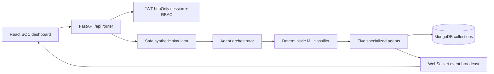
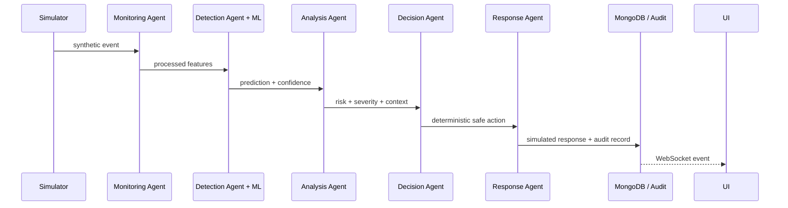
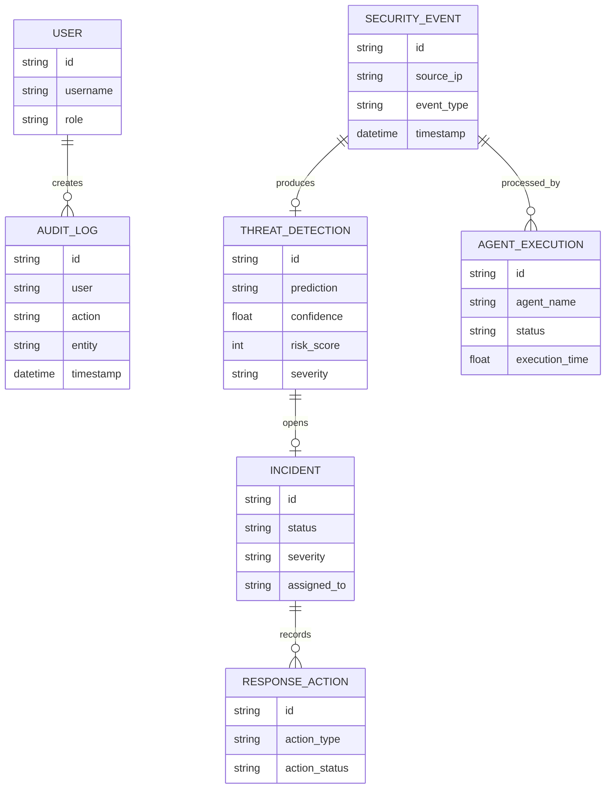

# farm-ts

Minimal split backend/frontend starter: **FastAPI + MongoDB** behind a
**Vite + React 19 + TypeScript** frontend, joined by a small typed fetch layer
over `/api`. This is a bare skeleton — no app features are implemented. Build on
top of it.

## Layout

```
farm-ts/
  backend/   FastAPI + motor (async MongoDB) + Pydantic v2 — python, /root/.venv
  frontend/  Vite + React 19 + Tailwind v4 + shadcn/ui (TypeScript strict)
  tests/     Playwright e2e workspace (pre-scaffolded)
```

## Running

Two separate processes, managed by supervisor in the pod (see "Pod conventions"
below); to run them by hand from two terminals instead:

```bash
cd backend && uvicorn server:app --host 0.0.0.0 --port 8001 --reload   # http://localhost:8001
cd frontend && yarn dev                                                # http://localhost:3000
```

## The `/api` proxy convention

Every backend route lives under `/api` (the backend mounts one
`APIRouter(prefix="/api")`), and the frontend dev server
(`frontend/vite.config.ts`) proxies `/api/*` to `http://localhost:8001`. So
frontend code always calls a **relative** path — `apiGet("/status")` →
`/api/status` — and never an absolute backend URL. The same code works in dev
(via the Vite proxy) and in production (once both are served behind a single
origin).

## Backend

FastAPI, async throughout. `python` is the app venv interpreter
(`/root/.venv/bin/python`); backend deps are pip-installed from
`backend/requirements.txt`.

- **Entry point**: `backend/server.py` — creates `app = FastAPI()`, creates
  `api_router = APIRouter(prefix="/api")`, registers routes **on the router**,
  and calls `app.include_router(api_router)` at the bottom. CORS middleware is
  added from `CORS_ORIGINS`. Never hang a route directly off `app` — it would
  land outside `/api` and the Vite proxy would not reach it.
- **The route pattern** (copy `status` in `server.py`):
  1. a Pydantic model per request body and per response
     (`StatusCheckCreate` / `StatusCheck`);
  2. an `async def` handler decorated with
     `@api_router.post("/status", response_model=StatusCheck)`;
  3. `await` the motor call inside it.
  FastAPI validates the request against the Pydantic model before your handler
  runs — a malformed body never reaches your code, it gets an automatic `422`
  with a `{"detail": [...]}` body.
- **Growing the backend**: as `server.py` gets crowded, move models to
  `backend/models/` and routers to `backend/routers/` (one module per resource,
  each exporting its own `APIRouter`, mounted from `server.py` via
  `api_router.include_router(...)` or `app.include_router(...)` with the `/api`
  prefix preserved).
- **MongoDB**: import the shared handle — `from lib.db import client, db`
  (`backend/lib/db.py` self-loads `.env` before reading env). Use it from
  `server.py`, every router, and standalone scripts like `seed.py`; never
  construct another `AsyncIOMotorClient`. Collections are attributes:
  `await db.status_checks.insert_one(...)`, `await db.status_checks.find().to_list(1000)`.
  Motor connects lazily, so importing `server` never blocks on Mongo. `pymongo`
  is installed too if you need a sync client in a script.
- **Ids**: documents use a string `id` (`uuid4`) field, not Mongo's `ObjectId`
  — `ObjectId` is not JSON-serializable and leaks into response bodies. Keep the
  `uuid4` default-factory pattern from `StatusCheck`.
- **Config**: `backend/.env` — `MONGO_URL` (connection string), `DB_NAME`
  (database name), `CORS_ORIGINS`. `server.py` loads it with `python-dotenv`
  above its local imports, and `lib/db.py` self-loads it so standalone scripts
  inherit it too. The pod runs `mongod` locally, so `MONGO_URL` points at
  `localhost`. Add new secrets/config here; read them with `os.environ`.
- **Dates**: `backend/lib/dates.py` — `today_iso(tz=None)`. The pod clock is
  UTC; anchor "today" server-side with this, never with client-side date math.
- **Interactive check**: `cd /app/backend && python -c 'import server'` catches
  syntax/import errors without waiting for the supervisor log.

## Frontend

- Vite + React 19 + TypeScript strict, dev server on port `3000`.
- Tailwind CSS v4 (via the `@tailwindcss/vite` plugin — no separate
  `tailwind.config.js` needed) + shadcn/ui, initialized with the `base-nova`
  style and `neutral` base color, `@` path alias (`@/*` → `src/*`) wired in both
  `tsconfig.app.json`/`tsconfig.json` and `vite.config.ts`.
- `react-router-dom` and `motion` are preinstalled — don't re-add them. `src/App.tsx`
  is the `<Routes>` table and nothing else; screens live in `src/pages/*.tsx` and are
  imported as `@/pages/<Name>`. `src/pages/Home.tsx` ships as the worked example. Add
  a `<Route>` for every page you write, in the same edit that creates the page — a
  page with no route is unreachable, and any URL without a matching `<Route>` renders a
  **blank page** — `<Routes>` matches nothing and mounts nothing.
- Components installed under `src/components/ui/`: button, card, input, label,
  select, dialog, sheet, tabs, badge, calendar, sonner, textarea, table, popover,
  dropdown-menu, checkbox. Add more with `npx shadcn@latest add <component>`.
- `src/lib/api.ts` — the typed fetch layer: `apiGet<T>`, `apiPost<T>`,
  `apiPut<T>`, `apiPatch<T>`, `apiDelete<T>`, all relative to base `/api`,
  throwing `ApiError` (with `status` and the parsed body) on any non-2xx.
  **Nothing infers across the Python boundary** — you declare the response type
  yourself as a TS interface mirroring the endpoint's Pydantic model, and keeping
  the two in sync is a manual discipline. When you change a Pydantic model,
  change its TS interface in the same edit.
- `src/pages/Home.tsx` is a minimal example of the wiring: TanStack Query's `useQuery`
  with `apiGet<StatusCheck[]>("/status")` as the `queryFn`. It is a **non-blocking
  connectivity probe**, not a proof of the round trip — the result is deliberately
  discarded so the splash renders identically with no backend. `apiGet<T>` does no
  runtime validation either; `T` is your assertion, not a check. See the
  static-preview rule in `TEMPLATE.md` §4 for why no page may be gated on a fetch.

## TypeScript

`frontend/tsconfig.app.json` / `tsconfig.node.json` have `strict: true`. In the
pod:

```bash
cd frontend && yarn typecheck
```

— plain `tsc --noEmit` run from `frontend/` checks ZERO files (root tsconfig uses
project references with `"files": []`) and exits 0 even with type errors. Always
use `-b` for the frontend. Lint with `cd frontend && yarn lint` (oxlint).

## Data fetching

TanStack Query is wired: `QueryClientProvider` in `src/main.tsx`, `useQuery` demo
in `src/pages/Home.tsx` (see above). Use `useQuery`/`useMutation`, not
fetch-in-`useEffect`.

## Completion gate (tier 1)

When the build is complete, run tier 1 once, all in the same turn: a curl smoke
over the key `/api` endpoints (assert status AND a response field, plus one
negative case), `cd frontend && yarn typecheck`, and ONE happy-path browser pass
through the core user journey. Clean on all three → finish; any failure is a real
bug — fix it, re-run the failed check, and escalate to the testing subagent.
No routine typecheck/lint/smoke passes during the build — tier 1 runs exactly once.


## Testing

Two lanes.

**Backend (pytest)** — specs in `backend/tests/` as `test_*.py`, run with:

```bash
cd /app/backend && pytest
```

`backend/pytest.ini` is canonical: `addopts = -n 2 --dist loadscope` (pytest-xdist,
already parallel — do not pass your own `-n`) and `asyncio_mode = auto` (so
`async def test_...` needs no marker). Serial is `-n 0`, **never**
`-p no:xdist` (that errors, because `addopts` still passes `-n`/`--dist`).
`backend/tests/conftest.py` is pre-scaffolded — a sync `client` fixture
(`httpx.Client` rooted at `/api`), an async `aclient`, and an `api_url()` helper,
all pointed at `BACKEND_URL` (default `http://localhost:8001`). Tests hit the
live uvicorn process, so the app under test is the one the browser sees. Add
app-specific fixtures below the marker; do not re-create the file.

**Frontend (Playwright)** — `/app/tests/` is pre-scaffolded:
`playwright.config.ts` (canonical — edit the marked lines only),
`fixtures/helpers.ts`, and a `package.json` that resolves
`@playwright/test@1.62.0` (node_modules baked into the image). Write specs into
`tests/e2e/`. Do NOT re-create the config/helpers or install/upgrade playwright —
matching Chromium browsers live at `/pw-browsers`.

The backend lane is pytest: this template's backend is Python, so `vitest` does
not apply to it.

## Pod conventions

This template runs under supervisord in the Emergent agent pod — supersedes any
local-run instructions above.

- Backend, frontend, and `mongod` are each a supervisor program. After code or
  config changes, restart and wait for readiness:

  ```bash
  sudo supervisorctl restart frontend backend
  until curl -sf -o /dev/null http://localhost:3000; do sleep 2; done
  ```

- Status, only after a restart you triggered:
  `sudo supervisorctl status frontend backend`. Logs:
  `/var/log/supervisor/backend.err.log`, `backend.out.log`,
  `frontend.err.log`.
- App in a browser: the pod's preview URL (frontend, port `3000`). Backend API
  directly at port `8001`.
- `mongod` runs locally in the pod (`--bind_ip_all`); `MONGO_URL` in
  `backend/.env` points at `localhost`, no separate Mongo container.
- Both dev servers hot-reload on file edits (uvicorn `--reload` for the backend,
  Vite HMR for the frontend); no rebuild step needed for normal iteration. A
  restart is still needed after changing `.env`, `requirements.txt`, or
  `vite.config.ts`.

## CyberGuard AI project guide

CyberGuard AI is the safe-mode academic Security Operations Center for “Threat
Detection & Enhanced Cybersecurity Using Agentic AI”. It combines a deterministic
local ML classifier with Monitoring, Detection, Analysis, Decision, and Response
agents. It uses only synthetic/controlled data and never attacks, scans, modifies,
isolates, locks, or accesses an external system.

### Architecture



The classifier answers “what pattern is this?”; the agents answer “what should
happen next?”. Risk scoring is a configurable project mechanism, not an
industry-standard score. All response labels are `SAFE_MODE` records only.





### Objectives, stack, and folder map

- Observe synthetic events in real time and preserve audit evidence
- Separate ML classification from agentic context analysis and safe decisions
- Show backend-driven KPIs, charts, incidents, reports, and WebSocket updates
- Keep SAFE_MODE enabled by default and make every simulated action explicit
- Frontend: React 19, Vite, TypeScript strict, Tailwind v4, shadcn/ui, Recharts, Lucide, TanStack Query
- Backend: FastAPI, Uvicorn, Pydantic v2, Motor, MongoDB, JWT, PBKDF2 password hashing
- ML: deterministic local demonstration classifier with computed metrics; no external LLM key required

```text
backend/models/soc.py             Pydantic boundary models
backend/routers/auth.py           JWT auth and development account
backend/routers/soc.py            dashboard, threats, agents, incidents, reports, settings, WebSocket
backend/services/soc_service.py  classifier, metrics, pipeline, simulator, broadcast, audit
frontend/src/pages/Home.tsx       login, responsive SOC shell, all MVP views
frontend/src/lib/api.ts           typed relative API boundary
memory/SPEC.md                    living specification
memory/test_credentials.md        development credentials
```

### Installation, testing, and API docs

```bash
cd /app/backend && python -m pip install -r requirements.txt
cd /app/frontend && yarn
sudo supervisorctl restart frontend backend
cd /app/frontend && yarn typecheck
cd /app/backend && python -m pytest
```

Manual run: `cd backend && uvicorn server:app --host 0.0.0.0 --port 8001 --reload`
and `cd frontend && yarn dev`. Public demo:
`https://cyberguard-soc-1.preview.emergentagent.com`. Local interactive API docs:
`http://localhost:8001/docs`.

Auth endpoints are `POST /api/auth/login`, `POST /api/auth/register`,
`GET /api/auth/me`, and `POST /api/auth/logout`. Dashboard endpoints are
`GET /api/dashboard/summary`, `/api/dashboard/timeline`, and
`/api/dashboard/threat-distribution`. Detection uses `POST /api/detection/analyze`
and `GET /api/detections/{id}`. Simulator controls are under
`/api/simulator/*`; models under `/api/models*`; incidents under
`/api/incidents*`; reports under `/api/reports/*`; audit and settings under
`/api/audit-logs` and `/api/settings`; health is `/api/health`.

### Demo workflow

1. Sign in with `admin` / `admin123` (seeded development ADMIN account).
2. Open Live Monitoring and press START; synthetic events use the same pipeline.
3. Review dashboard KPIs, five-agent activity, live feed, and SAFE_MODE banner.
4. Open Threat Detection, select a row, and review explanation and agent timeline.
5. Move an Incident through OPEN → INVESTIGATING → MITIGATED → RESOLVED.
6. Open Datasets to upload an NSL-KDD-style CSV/TXT and review its schema, classes, and preprocessing summary.
7. Review ML Models, Analytics, Audit Logs, then export CSV/PDF from Reports.

### Limitations and future work

Metrics are computed on the deterministic synthetic demonstration set and are
not NSL-KDD or production benchmarks. Uploaded datasets are profiled and tracked
but are not automatically used to replace the production model. Feedback labeling
and candidate-model approval, external LLM explanations, enterprise SIEM/SOAR
connectors, PostgreSQL migration, and real infrastructure integrations remain
future enhancements. No offensive or destructive functionality exists.
# cyberthreat-detection
